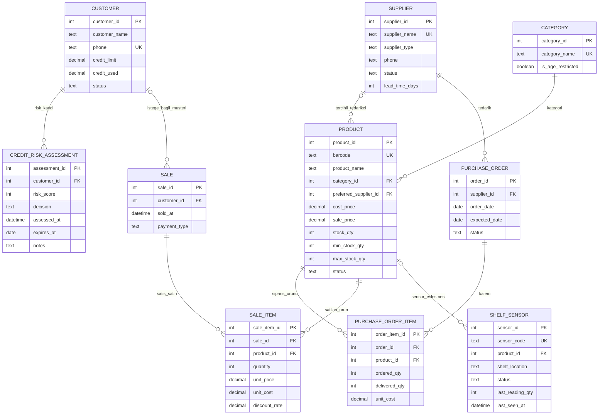

# ER Diyagramı — Otonom Stok Takibi ve Kredi Risk Kontrollü Perakende Veritabanı Mimarisi

Proje; perakende dükkânı, ürün kategorileri, tedarikçiler, satın alma kalemleri, satışlar, müşteriler, kredi risk değerlendirmeleri ve raf sensörlerinden oluşur. İki M:N ilişki (`purchase_order`–`product`, `sale`–`product`) ara tablolarda çözülmüştür.

## İlişki ve davranış açıklaması

Her ürün tam bir kategoriye aittir; tercihli tedarikçi isteğe bağlıdır. Her sipariş bir tedarikçiye, her sipariş kalemi bir siparişe ve bir ürüne bağlıdır. Her kredi risk değerlendirmesi bir müşteriye aittir. Satışın müşterisi isteğe bağlıdır; **kredi satışında müşteri zorunludur** (`chk_sale_credit_customer`). Raf sensörünün ürünü NULL olabilir.

`purchase_order_item` ve `sale_item` ara tabloları iki çoktan-çoğa ilişkiyi çözer. `sale_item.unit_price` ve `unit_cost`, satış anındaki fiyat/maliyetin kopyasıdır; fiyat sonradan değişse de geçmiş satışın kârı değişmez.
